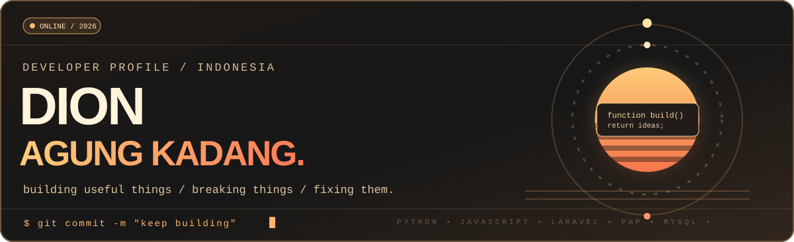
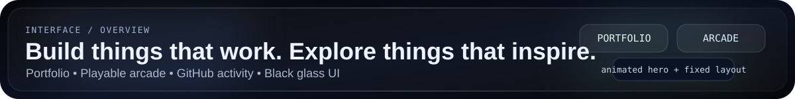
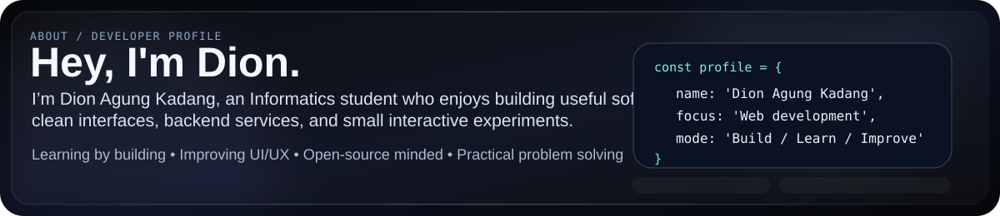
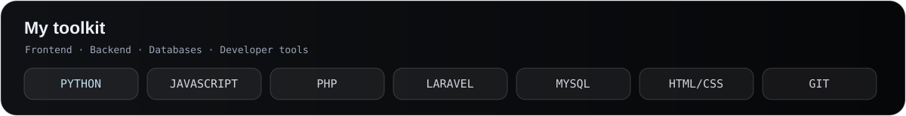
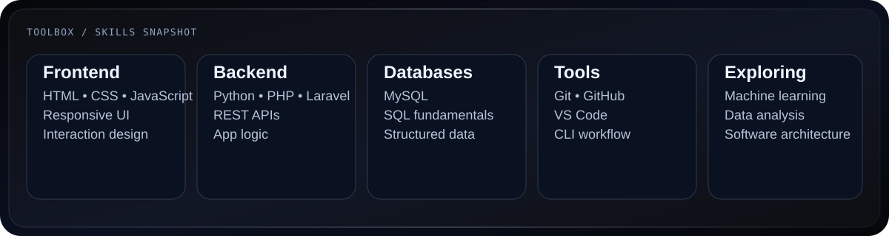
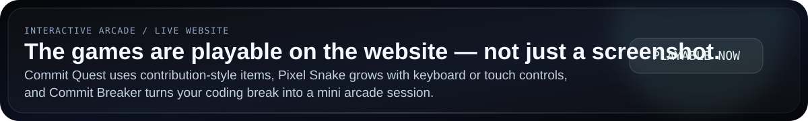
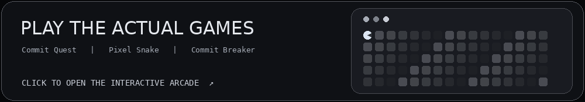
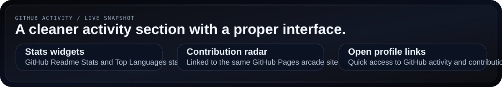
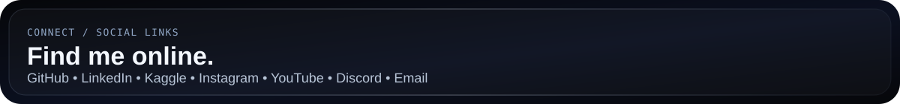

[**Explore interactive portfolio**](https://dion1727.github.io/dion1727/) &nbsp; · &nbsp; [**Play Commit Quest**](https://dion1727.github.io/dion1727/?game=quest#arcade) &nbsp; · &nbsp; [**Live GitHub activity**](https://dion1727.github.io/dion1727/#contributions)

## Hey, I'm Dion.

I’m **Dion Agung Kadang**, an Informatics student who enjoys turning ideas into useful software. I build web interfaces, backend services, and small interactive experiments using **Python, JavaScript, PHP, Laravel, and MySQL**.

## What I work with

  

## My interactive arcade

[**PLAY THE ACTUAL GAMES →**](https://dion1727.github.io/dion1727/?game=quest#arcade) &nbsp;&nbsp; [**SEE REAL CONTRIBUTIONS →**](https://dion1727.github.io/dion1727/#contributions)

GitHub README doesn’t run browser JavaScript. The playable games launch on GitHub Pages from the same repository.

## GitHub activity

  
  

[<b>Open contribution calendar and GitHub activity →</b>](https://dion1727.github.io/dion1727/#contributions)

## Find me online

<a href="https://github.com/dion1727"><b>GitHub</b></a> &nbsp; · &nbsp;
<a href="https://www.linkedin.com/in/Dion%20Agung%20Kadang/"><b>LinkedIn</b></a> &nbsp; · &nbsp;
<a href="https://www.kaggle.com/dionagungkadang"><b>Kaggle</b></a> &nbsp; · &nbsp;
<a href="https://www.instagram.com/dionmrfs_d/"><b>Instagram</b></a> &nbsp; · &nbsp;
<a href="https://www.youtube.com/@daizodn9742"><b>YouTube</b></a> &nbsp; · &nbsp;
<a href="https://discord.gg/diondn_"><b>Discord</b></a> &nbsp; · &nbsp;
<a href="mailto:dion1727agung@gmail.com"><b>Email</b></a>

Code. Build. Play. Repeat. · <a href="https://github.com/dion1727">@dion1727</a>

