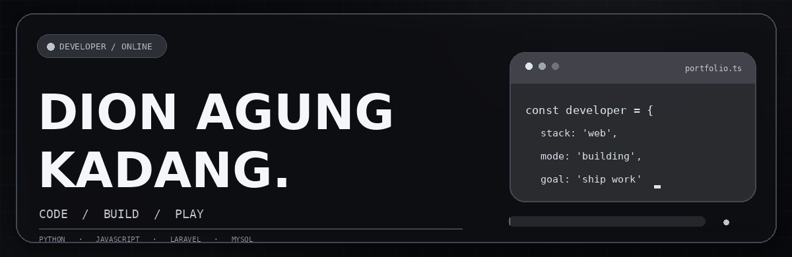
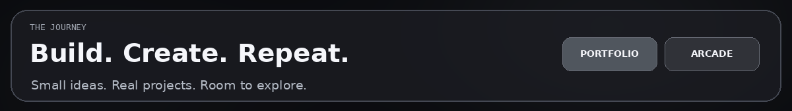
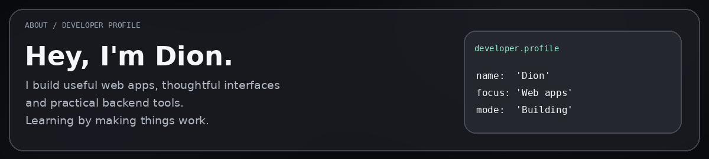
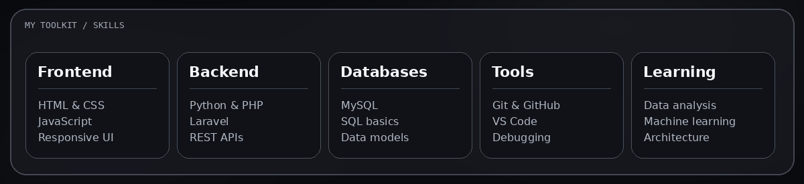
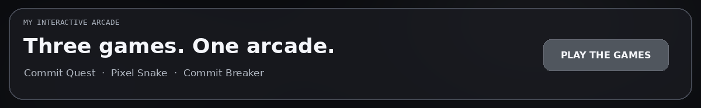
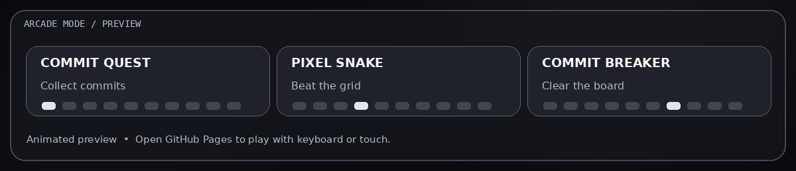
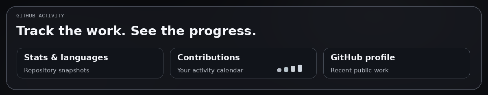
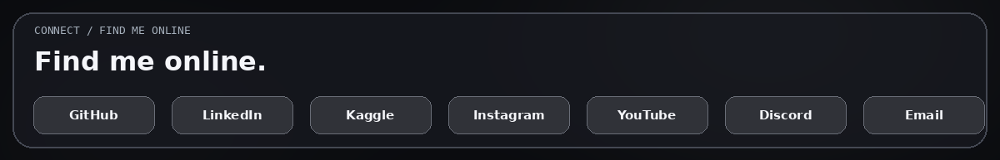

[**Explore portfolio**](https://dion1727.github.io/dion1727/) &nbsp; · &nbsp; [**Play Commit Quest**](https://dion1727.github.io/dion1727/?game=quest#arcade) &nbsp; · &nbsp; [**GitHub activity**](https://dion1727.github.io/dion1727/#contributions)

## Hey, I'm Dion.

I study Informatics and build useful web applications with **Python, JavaScript, PHP, Laravel, and MySQL**.

## What I work with

## My interactive arcade

[**▶ PLAY THE GAMES**](https://dion1727.github.io/dion1727/?game=quest#arcade) &nbsp; · &nbsp; [**View contributions**](https://dion1727.github.io/dion1727/#contributions)

## GitHub activity

<a href="https://dion1727.github.io/dion1727/#contributions"><b>View live GitHub activity</b></a>

## Find me online

<table>
<tr><td align="center"><a href="https://github.com/dion1727">GitHub</a></td><td align="center"><a href="https://www.linkedin.com/in/Dion%20Agung%20Kadang/">LinkedIn</a></td><td align="center"><a href="https://www.kaggle.com/dionagungkadang">Kaggle</a></td><td align="center"><a href="https://www.instagram.com/dionmrfs_d/">Instagram</a></td></tr>
<tr><td align="center"><a href="https://www.youtube.com/@daizodn9742">YouTube</a></td><td align="center"><a href="https://discord.gg/diondn_">Discord</a></td><td align="center"><a href="mailto:dion1727agung@gmail.com">Email</a></td><td align="center"><a href="https://github.com/dion1727?tab=repositories">Repositories</a></td></tr>
</table>

Code. Build. Play. Repeat. · <a href="https://github.com/dion1727">@dion1727</a>

