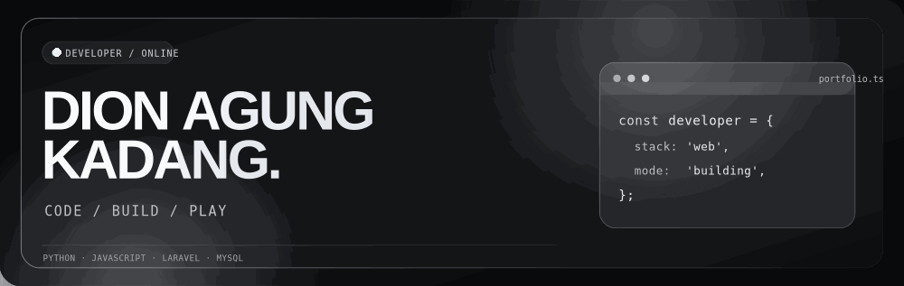

### Build things that work. Explore things that inspire.

[**Explore interactive portfolio**](https://dion1727.github.io/dion1727/) &nbsp; · &nbsp; [**Play Commit Quest**](https://dion1727.github.io/dion1727/#arcade) &nbsp; · &nbsp; [**Live GitHub activity**](https://dion1727.github.io/dion1727/#contributions)

## Hey, I'm Dion.

I'm **Dion Agung Kadang**, an Informatics student who enjoys turning ideas into useful software. I build web interfaces, backend services, and small interactive experiments using **Python, JavaScript, PHP, Laravel, and MySQL**.

I enjoy practical problem solving, clean UI/UX, open-source learning, and making code easier to maintain.

## What I work with

  

**Frontend:** HTML · CSS · JavaScript · Responsive UI · Interaction design  
**Backend:** Python · PHP · Laravel · REST APIs  
**Databases:** MySQL · SQL fundamentals  
**Tools:** Git · GitHub · VS Code  
**Exploring:** machine learning · data analysis · software architecture

## My interactive arcade

The games are playable on my website—not a screenshot inside the README. **Commit Quest** turns my GitHub contribution calendar into collectible points. **Pixel Snake** and **Commit Breaker** can be played with keyboard or touch controls.

[**PLAY THE ACTUAL GAMES →**](https://dion1727.github.io/dion1727/?game=quest#arcade) &nbsp;&nbsp; [**SEE REAL CONTRIBUTIONS →**](https://dion1727.github.io/dion1727/#contributions)

GitHub README doesn't run browser JavaScript. The game launches on GitHub Pages.

## GitHub activity

  
  

[**Open contribution calendar and GitHub activity →**](https://dion1727.github.io/dion1727/#contributions)

## Find me online

[**GitHub**](https://github.com/dion1727) &nbsp; · &nbsp; [**LinkedIn**](https://www.linkedin.com/in/Dion%20Agung%20Kadang/) &nbsp; · &nbsp; [**Kaggle**](https://www.kaggle.com/dionagungkadang) &nbsp; · &nbsp; [**Instagram**](https://www.instagram.com/dionmrfs_d/) &nbsp; · &nbsp; [**YouTube**](https://www.youtube.com/@daizodn9742) &nbsp; · &nbsp; [**Discord**](https://discord.gg/diondn_) &nbsp; · &nbsp; [**Email**](mailto:dion1727agung@gmail.com)

Code. Build. Play. Repeat. · <a href="https://github.com/dion1727">@dion1727</a>

