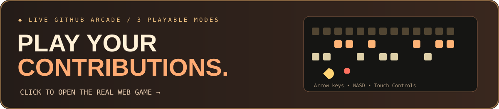

### Building things for the web, one experiment at a time.

**Python &nbsp; / &nbsp; JavaScript &nbsp; / &nbsp; Laravel &nbsp; / &nbsp; PHP &nbsp; / &nbsp; MySQL**

[About](#a-little-about-me) · [Play](#play-the-arcade) · [Activity](#contribution-games) · [Connect](#find-me-online)

### A little about me

Hey, I'm **Dion Agung Kadang**. I'm an Informatics student who enjoys building real applications, clean user interfaces, and useful backend systems. Most days I'm learning, experimenting, debugging, and finding better ways to write code.

I work with **Python, JavaScript, PHP, Laravel, HTML, CSS, MySQL, and Git**. Outside of bigger projects, I make little coding experiments and browser games just for fun.

### Play the arcade

**[PLAY COMMIT QUEST](https://dion1727.github.io/dion1727/?game=quest)** &nbsp; · &nbsp; **[PLAY PIXEL SNAKE](https://dion1727.github.io/dion1727/?game=snake)** &nbsp; · &nbsp; **[PLAY COMMIT BREAKER](https://dion1727.github.io/dion1727/?game=breaker)**

The games above are interactive JavaScript applications on GitHub Pages. The image is an animated entrance, not the game itself. README cannot run JavaScript.

### Contribution games

These animations are generated automatically from **my real GitHub contribution graph**, not invented activity. They appear after the *After Hours - Animated contribution games* GitHub Action completes successfully.

<b>▶ Open the animated Pac-Man contribution graph</b> (available after running the GitHub Action)

<picture>
  <source media="(prefers-color-scheme: dark)" srcset="https://raw.githubusercontent.com/dion1727/dion1727/arcade-output/pacman-contribution-graph-dark.svg" />
  <source media="(prefers-color-scheme: light)" srcset="https://raw.githubusercontent.com/dion1727/dion1727/arcade-output/pacman-contribution-graph.svg" />
  
</picture>

[▶ Interactive contribution board](https://dion1727.github.io/dion1727/#radar) · [View GitHub activity](https://github.com/dion1727?tab=overview)

### Find me online

Code. Build. Play. Repeat.

