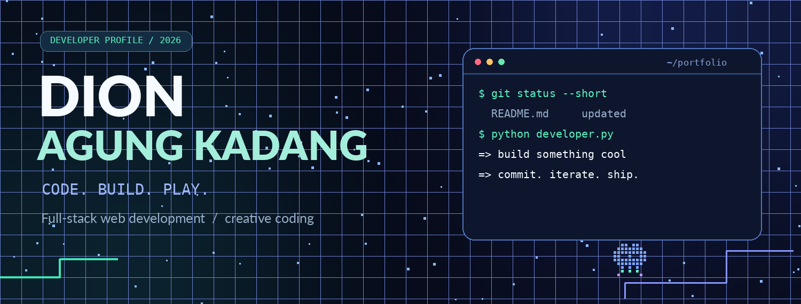
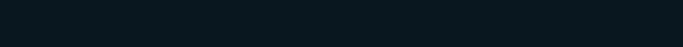
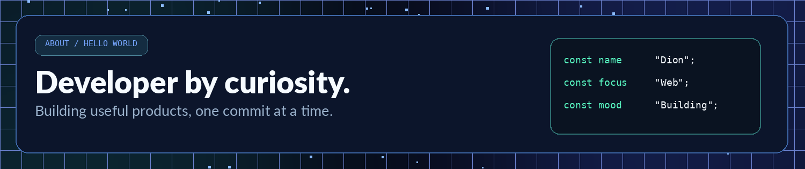
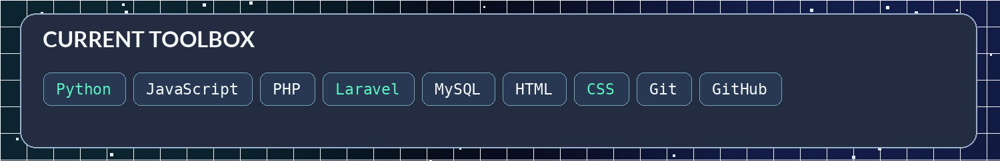
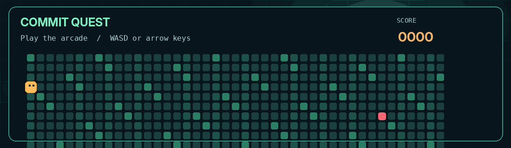
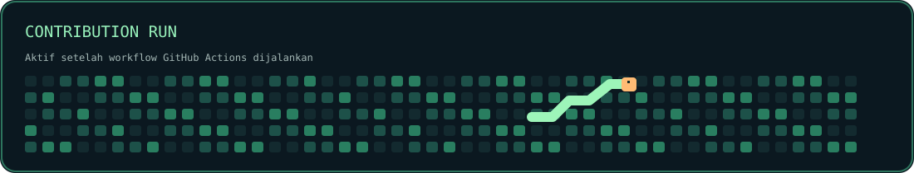
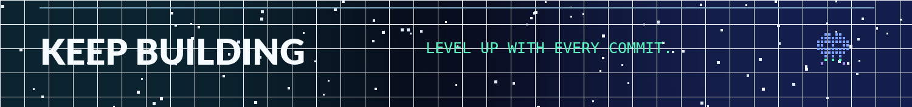

<a href="#hello">About</a> &nbsp; / &nbsp; <a href="#toolbox">Toolbox</a> &nbsp; / &nbsp; <a href="#arcade">Play Arcade</a> &nbsp; / &nbsp; <a href="#activity">Contributions</a> &nbsp; / &nbsp; <a href="#contact">Connect</a>

## Hey, I'm Dion.

I'm an Informatics student who enjoys building websites, writing backend logic, and shaping interfaces until they feel right. I work with Python, Laravel, JavaScript and MySQL — and I like experimenting with small browser games as much as useful applications.

## Things I build with

## Play a little game

**Commit Quest:** grab green commits and dodge the moving bugs. **Pixel Snake:** collect tiles and aim for a new high score. Both games have keyboard and touch controls, with scores saved in the browser.

### <a href="https://dion1727.github.io/dion1727/">PLAY THE ARCADE ↗</a>

The animated preview is shown here. The playable games open on GitHub Pages once Pages is enabled.

## Contribution playground

This illustration is replaced by an animated snake based on real contribution data after the workflow succeeds.

## Let's connect

Open to interesting web projects, debugging stories and creative experiments.

<a href="https://github.com/dion1727">GitHub</a> &nbsp; / &nbsp; <a href="mailto:dion1727agung@gmail.com">Email</a> &nbsp; / &nbsp; <a href="https://instagram.com/dionmrfs_d">Instagram</a>

